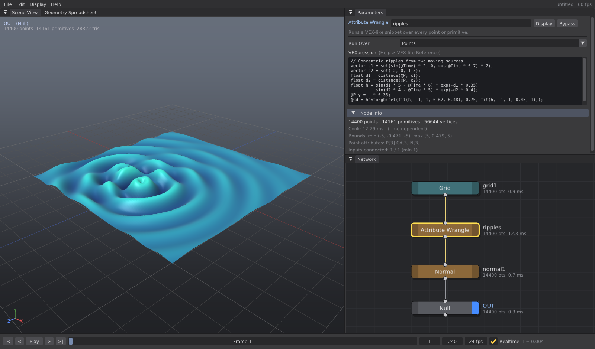
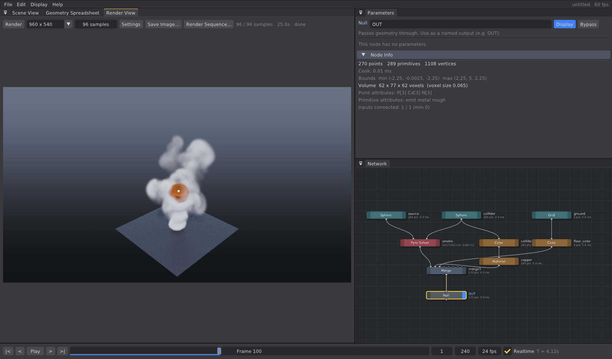
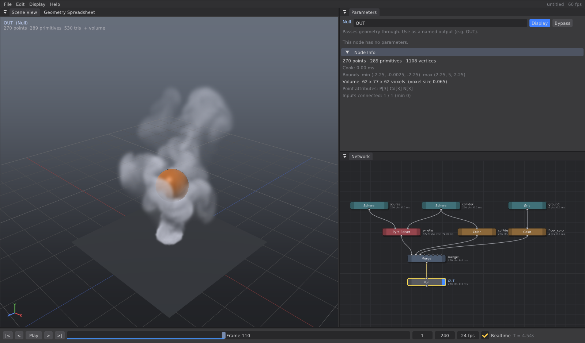
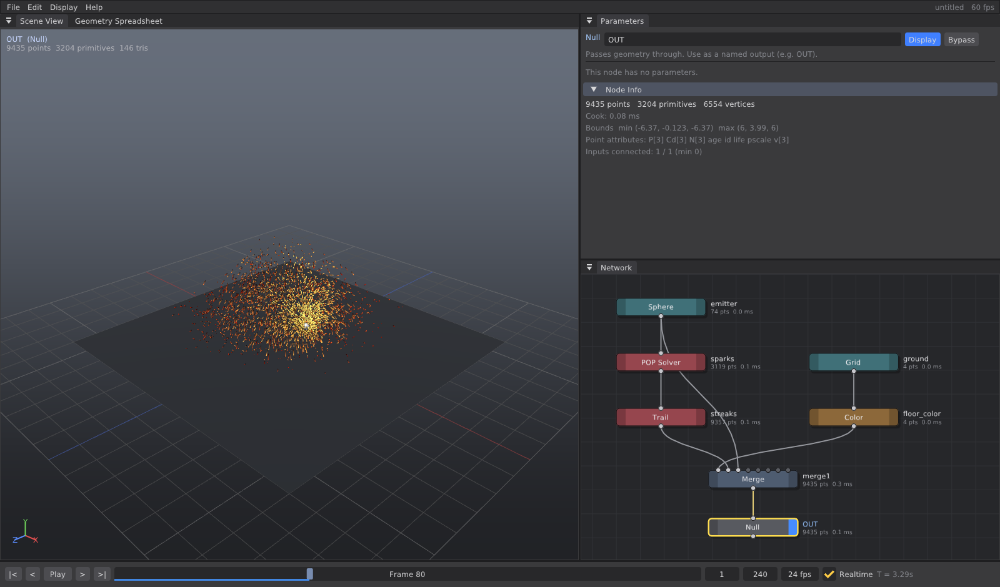
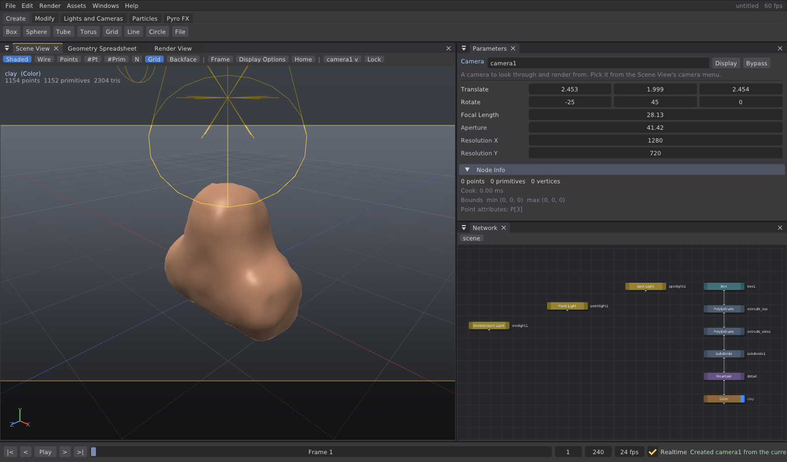
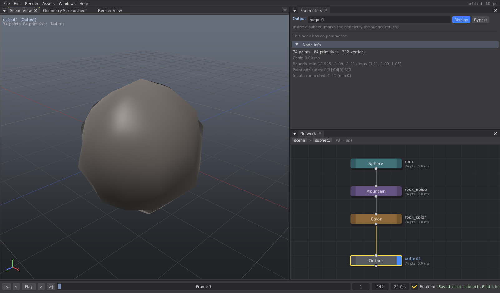
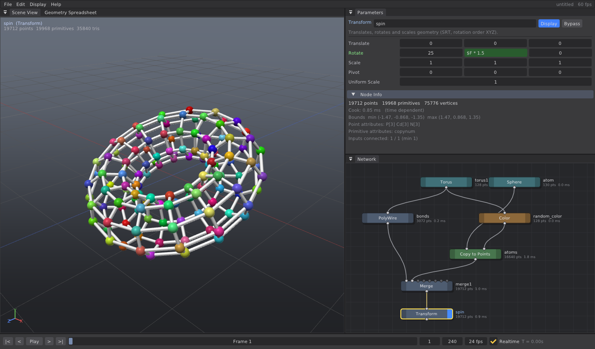

# HD — procedural 3D VFX environment

HD is a node-based procedural 3D program in the spirit of Houdini. It's a native C++ desktop app for macOS, Windows and Linux. You build geometry by wiring nodes together in a network. Every change re-cooks live in an OpenGL viewport, and any parameter can be animated with expressions.



So far it has the **procedural core** (geometry engine, node graph, a VEX-like snippet language, viewport, Houdini-style UI) a **particle system** (POP solver), **smoke and fire** (Pyro solver with volume rendering), and a **path-traced Render View** that saves images and sequences.

## Features

- **Network editor.** Nodes flow top to bottom as in Houdini. Press **Tab** (or right-click) to open a searchable node menu. Drag from an output to an input to connect; drag a wire onto empty space to add a node that's already connected. The **blue flag** sets the display node and the **yellow flag** bypasses a node. Also: box select, duplicate, rename, error badges and per-node cook stats.
- **43 nodes**:
  - Generators: Box, Sphere, Grid, Tube, Torus, Circle, Line, File (OBJ)
  - Modifiers: Transform, Merge, Subdivide (Catmull-Clark), PolyExtrude, Fuse, Facet, Reverse, Blast, PolyWire
  - Deformers: Mountain (fractal noise), Smooth, Peak, Point Jitter
  - Points: Scatter (area weighted), Copy to Points (orients to `N`/`up`, scales by `pscale`/`scale`, transfers `Cd`)
  - Attributes: Attribute Wrangle, Attribute Create, Color, Normal, Material
  - Utility: Null, Switch, Subnetwork, Subnet Input, Output
  - Lights and Cameras: Camera, Point Light, Spot Light, Area Light, Distant Light, Environment Light
  - Simulation: POP Solver, Trail, Pyro Solver
  - Volumes: Fog Volume
- **VEX-lite.** A small snippet language for Attribute Wrangle, expression groups and parameter expressions. It supports `@P`, `@N`, `@Cd`, `v@foo`/`f@foo`, `@ptnum`, `@Time`, `@Frame`, `if`/`for`, vector math, `noise`, `curlnoise`, `rand`, `fit`, `hsvtorgb` and more.
- **Particles.** The POP Solver emits from any surface or point set (continuous or a single burst) and simulates frame by frame: gravity, wind, air resistance, curl-noise turbulence, ground and sphere collisions (bounce, stick or die), and color and size over life. A **POP wrangle** snippet runs every substep with `@v`, `@age`, `@life`, `@id` and `@TimeInc`. Simulated frames are cached, so scrubbing back is instant; the blue bar on the timeline shows what's cached. Changing the solver or anything upstream re-simulates. Trail turns velocities into streaks.
- **Smoke and fire.** The Pyro Solver is a grid fluid simulation. Smoke is emitted from any closed mesh (or points), rises with buoyancy, swirls (vorticity confinement plus curl-noise turbulence), fades and cools, and flows around an optional collider mesh. Turn up **Fire Intensity** to make hot gas glow. Frames are cached like particles. Fog Volume fills a mesh with static fog. Volumes are raymarched in the viewport with self-shadowing and are correctly hidden behind solid geometry. Volumes follow Transform (move and scale, not rotate) and Merge; they aren't written by OBJ/PLY export.
- **Render View.** A progressive path tracer renders the displayed node from the Scene View camera: sun with soft shadows, sky light, bounced light, glossy and metallic surfaces, glowing (emissive) surfaces and particles, and smoke and fire with shadows. The **Material** node sets roughness, metallic and glow per primitive or point. Sun, sky, exposure, ground plane and curve thickness are under **Settings** and are saved with the scene, along with the camera. **Save Image** writes a PNG; **Render Sequence** renders the timeline range to numbered PNGs. PNGs are written uncompressed, so they are large (about 2.7 MB at 1280 x 720).
- **Animation.** Right-click any parameter and choose **Add Expression** (e.g. `sin($T*2)`, `$F*1.5`). Nodes that depend on time recook during playback; everything else stays cached.
- **Groups.** Group fields take `0-10 15 20-40:2`, an expression such as `@P.y > 0`, and `!` to invert.
- **Viewport.** Smooth-shaded surfaces with wireframe overlay, points (sized by `pscale` for point clouds), normals, point and primitive numbers, a ground grid and an axis gizmo. Rendering uses 4× MSAA.
- **Shelf.** A row of tool tabs across the top, as in Houdini: **Create**, **Modify**, **Lights and Cameras**, **Particles** and **Pyro FX**. Clicking a tool adds the node, continuing from the selected node when the tool takes an input.
- **Lights and cameras.** Camera, Point, Spot, Area, Distant and Environment lights, plus Sky Light (sun and sky) and Ambient Light on the shelf. They are scene-level nodes, like Houdini objects: every light or camera in the top-level network is part of the scene without being wired in, and bypassing one turns it off. Shelf lights are placed and aimed at whatever is displayed. Lights show as icons in the viewport and light the Render View (not the viewport's own shading); once a scene has any light, the default sun and sky are no longer used. Pick a camera from the Scene View's camera menu to look through it; **Lock** makes view navigation move the camera, and the Render View renders through the active camera at its resolution. **Camera** on the shelf creates one from the current view. Camera roll (Z rotation) is ignored. Geometry, Volume, GI, Caustic and Portal lights and stereo/VR cameras are greyed out.
- **Subnetworks.** Select nodes and press **Shift+C** to collapse them into a single Subnetwork node, wired in their place. Double-click it (or press **I**) to dive in and edit; **U** or the breadcrumb at the top of the Network goes back up. Outside wires arrive through Subnet Input nodes (up to 4) and the Output node is the result. Subnets nest, save with the scene, and can contain simulations.
- **Assets.** Right-click a subnet and choose **Save As Asset** to store it in your asset folder (`~/.hd_assets`). Assets appear in the Tab menu under **Assets** in every scene, and the **Assets** menu has an Asset Manager and an installer for `.hda` files from someone else. Each asset you add is an independent copy: editing it doesn't change the saved asset or other copies, and assets don't expose parameters on the outside yet.
- **Menus.** The menu bar follows Houdini's layout: **File** (recent files, Save and Increment, Revert, Merge, Import, Export), **Edit** (cut, copy, paste, preferences), **Render**, **Assets**, **Windows** (show or hide each pane, reset the layout) and **Help**. Entries for things HD doesn't have yet (Alembic/FBX/USD, render nodes, Python shell) are greyed out.
- **Display Options.** Press **D** in the viewport. The Grid tab sets the ground reference plane (on/off, XZ/XY/YZ, origin, spacing, size, ruler lines, opacity); other tabs cover markers, shading and background colors. These settings are remembered between sessions.
- **Geometry Spreadsheet.** Shows every point and primitive attribute of the selected node.
- **Timeline.** Play, step, set the frame range and fps.
- **Files and history.** Undo/redo for everything, scenes saved as `.hdg` (readable JSON), OBJ import/export and PLY point export. You can drag `.hdg` and `.obj` files onto the window.
- **`hdc`.** A headless command-line tool, similar to `hbatch`, for cooking scenes and exporting geometry or whole frame sequences.













## Download

Every push to `main` builds the app on GitHub Actions. To get it, open **Actions → Build → latest run → Artifacts**:

| Platform | Artifact |
|---|---|
| macOS (Apple Silicon + Intel) | `HD-macOS.dmg` |
| Windows | `HD-Windows.zip` |
| Linux | `HD-Linux.tar.gz` |

Pushing a tag like `v0.1.0` also publishes these files as a GitHub Release.

> **macOS:** the app isn't code-signed. The first time you open it, right-click `HD.app` and choose **Open**.

## Build from source

You need CMake 3.20+ and a C++17 compiler. GLFW and Dear ImGui are downloaded automatically.

```bash
cmake -S . -B build -DCMAKE_BUILD_TYPE=Release
cmake --build build --config Release --parallel
ctest --test-dir build -C Release          # core engine tests
```

- **macOS:** Xcode command line tools are enough. The app is `build/HD.app`.
- **Windows:** Visual Studio 2022. The app is `build/Release/HD.exe`.
- **Linux:** `sudo apt install xorg-dev libgl1-mesa-dev`, then add `-DGLFW_BUILD_WAYLAND=OFF` if the Wayland development packages aren't installed.

## Controls

| Where | Action | Input |
|---|---|---|
| Network | Add node | **Tab** or right-click (type to search, Enter to add) |
| | Connect | Drag from a node's output (bottom) to an input (top) |
| | Add connected node | Drag a wire into empty space |
| | Re-wire / disconnect | Drag from a connected input |
| | Display / bypass | Click the right (blue) or left (yellow) strip of a node |
| | Pan / zoom | Middle-drag or Alt+drag / mouse wheel |
| | Delete, duplicate, rename | Del, Ctrl+D, F2 or double-click |
| | Frame all nodes | H |
| | Collapse selection into a subnet | Shift+C |
| | Dive into a subnet / go up | I or double-click / U |
| Viewport | Tumble / pan / dolly | Left / middle / right drag; wheel zooms |
| | Frame geometry / home | F / H |
| | Wireframe overlay | W |
| | Display Options (ground plane) | D |
| Global | Previous / next frame | Left / Right arrow |
| | Play / stop | Alt+Up, or the Play button |
| | Undo / redo | Ctrl+Z / Ctrl+Shift+Z |
| | New / open / save | Ctrl+N / Ctrl+O / Ctrl+S |
| | Copy / cut / paste nodes | Ctrl+C / Ctrl+X / Ctrl+V |

On macOS, use Cmd wherever the table says Ctrl.

## VEX-lite quick reference

```c
// Attribute Wrangle runs once per point (or per primitive)
float d = length(@P);
@P.y += sin(d * 4 - @Time * 3) * 0.15;      // animated ripple
@Cd = hsvtorgb(set(fit(d, 0, 5, 0.55, 0.95), 0.7, 1));
if (@ptnum % 2 == 0) @pscale = rand(@ptnum) * 0.1;   // new float attribute
v@vel = curlnoise(@P * 0.5);                 // new vector attribute
```

- Vector attributes: `P N Cd v up uv rest scale force`. Any other `@name` is a float unless you write `v@name`.
- Read-only values: `@ptnum @numpt @primnum @numprim @Time @Frame @TimeInc`.
- Functions: `sin cos tan asin acos atan atan2 sqrt abs floor ceil frac rint pow exp log min max clamp fit fit01 lerp smooth length normalize distance dot cross set noise curlnoise rand hsvtorgb degrees radians sign mod`.
- Parameter expressions use `$F`, `$T`, `$FPS` and `$PI`, plus all of the functions above.

## Examples

`examples/` contains `terrain`, `ripples` (animated), `city`, `sculpt`, `molecule`, the particle scenes `sparks` and `vortex`, and the pyro scenes `smoke` and `fire` (press Play). The same scenes are available inside the app under **File → Open Example**.

## Command line (`hdc`)

```bash
hdc nodes                                   # list node types
hdc info examples/terrain.hdg               # cook every node and print stats
hdc cook examples/city.hdg city.obj         # export the display node
hdc frames examples/ripples.hdg out_$F.obj 1 48   # export a frame sequence
hdc render examples/smoke.hdg smoke.png --frame 90 --samples 64   # path-trace a frame
hdc render examples/fire.hdg fire.png --frames 1 48          # fire.0001.png ...
hdc render scene.hdg shot.png --camera camera1                # through a camera node, using the scene's lights
hdc demo terrain my_scene.hdg               # write a demo scene
```

## Architecture

```
src/core/     engine (no UI deps): Geometry + attributes, node graph with cook caching
              and time dependence, VEX-lite compiler/interpreter, SOP nodes, particle
              and smoke solvers with per-frame caches, voxel volumes, CPU path tracer, OBJ/PLY, JSON scene format
src/render/   OpenGL 3.3 core renderer (own loader, MSAA framebuffer, shaders)
src/app/      Dear ImGui UI: network editor, parameters, viewport, spreadsheet, timeline
src/tools/    hdc command-line tool
tests/        core tests + Linux headless render/UI screenshot harnesses (EGL)
```

A node recooks only when its parameters, inputs or bypass state change, or when it depends on time and the frame changes. Everything else is served from cache.

## Roadmap

1. ~~Particles / POP solver~~ — done. Next for particles: collisions against arbitrary meshes, particle-to-particle forces.
2. ~~Smoke and fire~~ — done (dense grids). Next for volumes: sparse grids, volume wrangle, convert volumes to and from meshes.
3. Packed primitives and instancing, plus a GPU path for heavy copies.
4. ~~Path-traced render view~~ — done. Next for rendering: denoising, textures, area lights, depth of field, compressed image output.
5. ~~Subnetworks and assets~~ — done. Next: parameters promoted to the outside of a subnet, linked (locked) assets, Python scripting.
